<picture>
  <source media="(prefers-color-scheme: light)" srcset="./assets/hero-light.svg" />
  
</picture>

<picture>
  <source media="(prefers-color-scheme: light)" srcset="./assets/about-light.svg" />
  
</picture>

<picture>
  <source media="(prefers-color-scheme: light)" srcset="./assets/principles-light.svg" />
  
</picture>

<picture>
  <source media="(prefers-color-scheme: light)" srcset="./assets/stack-light.svg" />
  
</picture>

<picture>
  <source media="(prefers-color-scheme: light)" srcset="./assets/contrib-heatmap-light.svg" />
  
</picture>

<picture>
  <source media="(prefers-color-scheme: light)" srcset="./assets/year-in-review-light.svg" />
  
</picture>

<picture>
  <source media="(prefers-color-scheme: light)" srcset="./assets/footer-light.svg" />
  
</picture>

